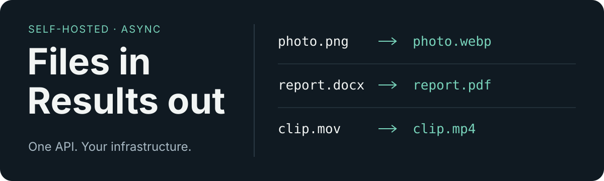

# 🐙 OctoConv

Self-hosted file conversion for your services. Upload through one HTTP API,
follow the job, and download the result — or receive a signed webhook.

<p align="center">
  <picture>
    <source media="(max-width: 600px)" srcset="assets/readme/hero-mobile.svg">
    
  </picture>
</p>

[](go.mod)
[](LICENSE)

[Quick start](#quick-start) · [Formats](docs/FORMATS.md) ·
[API reference](docs/openapi.yaml) · [Documentation](docs/README.md)

## What it does

| Files | Operations |
|---|---|
| Images | Convert PNG, JPEG, WebP, HEIC and TIFF |
| Documents & markup | Office → PDF, HTML → PDF, LaTeX → PDF, curated Pandoc conversions |
| Audio & video | Transcribe speech, transcode video, extract audio and thumbnails |
| Scans | OCR from images and PDFs into text, hOCR or ALTO |
| CAD | STEP/IGES → STL, DXF → SVG/PDF, PNG previews with measurements |
| Content inspection | Inspect supported files or rebuild them with the `sanitize` operation |

3D CAD previews show dimensions by default. See [CAD options](docs/CAD.md) for
views, transparency, size limits and `dimensions: false`.
The live `GET /v1/formats` endpoint lists the supported format pairs and operations.

## Why OctoConv

- **One integration.** API keys, job status, progress events, presets and callbacks
  work across the conversion engines. [MCP clients](docs/MCP.md) use the same API.
- **Bounded processing.** Upload validation, per-client quotas, engine timeouts and
  filesystem confinement limit what a submitted file can do.
- **Recoverable jobs.** PostgreSQL records job state; a reconciler recovers stranded
  work. Separate worker queues let each engine pool scale independently.

Built for service-to-service use inside an organization. Public multi-tenancy and
billing are outside its scope. [Operations](docs/OPERATIONS.md) explains the
security boundaries, recovery and deployment requirements.

## Setup

You need **Go 1.27.3+**, **Docker with Compose**, and a Linux Docker host or VM
with Landlock support. Workers refuse to start if required confinement is unavailable.

From the repository root, start the image-conversion path:

```bash
cp .env.example .env
# Set API_KEY_SALT to your own random value in .env before creating a key.
docker compose up -d --wait postgres redis minio
docker compose run --rm createbucket

set -a
. ./.env
set +a
go run ./cmd/migrate
docker compose up -d --build worker webhook-worker-1
go run ./cmd/manage-clients create "demo"
# Save the printed API key; it is shown only once.
go run ./cmd/api
```

The API runs locally so its download URLs use `localhost:9100`. This starts only
the image worker and recovery service. See [local setup](docs/GETTING-STARTED.md)
for other engines, the full Compose stack, ports and existing-volume migration.

## Quick start

In a second terminal, use the key above to convert a checked-in sample:

```bash
export OCTOCONV_API_KEY='<your-api-key>'
curl -sS http://localhost:8090/v1/jobs \
  -H "Authorization: ApiKey $OCTOCONV_API_KEY" \
  -F file=@internal/convert/testdata/ocr/text_sample.png \
  -F target=webp
# {"job_id":"...","status":"queued"}
```

Use the returned job ID to poll until `status` is `done`, then download from
`download_url`:

```bash
curl -sS "http://localhost:8090/v1/jobs/<job_id>" \
  -H "Authorization: ApiKey $OCTOCONV_API_KEY"
curl -L '<download_url>' -o result.webp
```

For completion notifications, submit an HTTPS `callback_url`; for live progress,
subscribe to `GET /v1/jobs/{id}/events`. [HTTP API](docs/API.md) covers these routes,
status codes and request limits.

## Documentation

| Start here | Details |
|---|---|
| [Local setup](docs/GETTING-STARTED.md) | Startup, API keys, ports and full-stack prerequisites |
| [Formats & operations](docs/FORMATS.md) | Conversion engines and supported routes |
| [HTTP API](docs/API.md) · [OpenAPI](docs/openapi.yaml) | Requests, status semantics and integration contract |
| [Operating OctoConv](docs/OPERATIONS.md) | Architecture, quotas, recovery, sandboxing and configuration |
| [CAD](docs/CAD.md) · [Measurements](docs/MEASUREMENTS.md) | Preview options and geometry output |
| [MCP integration](docs/MCP.md) | Local stdio and in-cluster HTTP servers |
| [All documentation](docs/README.md) | Inspection, sanitization, typesetting and error codes |

The optional [web workspace](https://github.com/tileforge/octoconv-ui) is a
separate private repository. The API and workers run independently of it.

## Development

```bash
go build ./...
go vet ./...
go test ./... -timeout 25m
```

Tests that need external services are opt-in. See [scripts/ci-local.sh](scripts/ci-local.sh)
for the broader checks and [AGENTS.md](AGENTS.md) for review rules. Keep API changes
backward-compatible and include the relevant validation in your pull request.

## License

[MIT](LICENSE).
